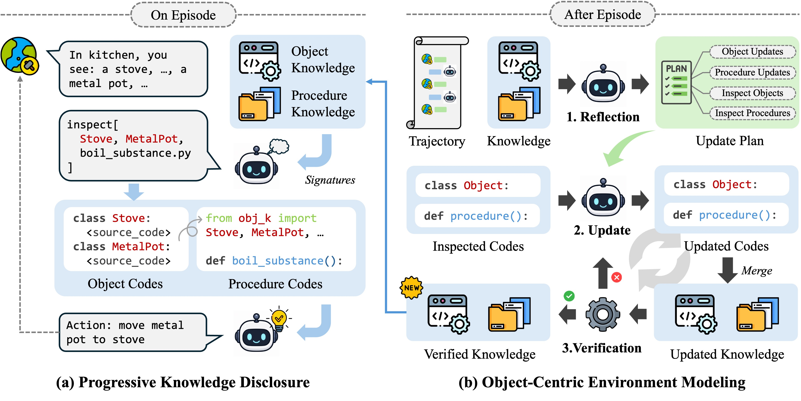

# OCM

[](https://arxiv.org/abs/2607.02846)
[](LICENSE)

Official implementation for **Object-Centric Environment Modeling for Agentic
Tasks**.

<p align="center">
  
</p>

## Overview

Large language model agents can improve through accumulated experience, but
free-form textual memories become difficult to maintain, validate, and reuse as
interactions grow. OCM organizes experience into an executable object-centric
environment model.

During evaluation, OCM maintains two connected code bases:

- object knowledge in `knowledge/object_knowledge.py`, which defines environment
  entities and mechanisms as Python classes;
- procedural knowledge under `knowledge/procedural_knowledge/`, which records
  reusable interaction patterns that import and use the object model.

The canonical `ocm` agent combines OCM's structured code memory with a
WorldEvolver-style predict-observe-update loop. The policy uses OCM to choose a
primitive action, then the same object/procedural code is used to predict the
action's immediate observable transition and its expected contribution to the
goal before execution. Each component records its own supporting knowledge ids;
either may cite object or procedural knowledge, or leave its references empty.
These are hypotheses, not observations or hard action gates.
The policy then sees that fallible foresight and may keep or revise
its proposed action. If it revises, OCM predicts the final action as well, so the
prediction later used for learning always corresponds to the action actually
executed.

After execution, the prediction is paired with the real observation, reward,
success, and validity signals in a separate learning trace. Policy and predictor
share the full thought/action/observation history without past prediction fields;
only policy review receives the current candidate action's foresight. At episode
end, reflection uses the prediction-observation trace to update the same object
and procedural code used for future predictions. This gives one closed loop: act from OCM, predict, observe, and
revise OCM. Reflection receives cited source files and links to the exact step
and prediction component using each claim. It can revise uncited knowledge too.
Observed state changes and goal progress are assessed separately, using the full
executed trajectory; zero immediate reward does not automatically imply no progress.
The writer applies source patches with format/compiler feedback on retries.
Reflection describes knowledge changes and their evidence, not complete replacement
workflows; the writer applies those changes to the existing source.
The logs expose both prediction components, their references, action revisions,
and knowledge edits, without a separate predicted-validity/effect classifier.

The runner currently supports:

- `sciworld`: ScienceWorld task environments.
- `alfworld`: ALFWorld household instruction-following tasks.
- `plancraft`: Minecraft-style crafting tasks.
- `webshop`: WebShop text shopping tasks.

Raw benchmark repositories, cached datasets, model outputs, and analysis
artifacts are intentionally not included in this source release.

## Setup

Create a Python environment and install the dependencies:

```bash
conda create -n oom python=3.10
conda activate oom
python -m pip install -r requirements.txt
```

Benchmark data and runtime notes:

- ScienceWorld and PlanCraft work from the Python dependencies above.
- ALFWorld needs its data downloaded with `alfworld-download`.

Set one API key for the provider you plan to use:

```bash
export OPENAI_API_KEY=...
# or, if using OpenRouter
export OPENROUTER_API_KEY=...
```

## Quick Start

Run a small OCM evaluation:

```bash
python main.py \
  --provider openai \
  --model-name gpt-4.1-mini \
  --agent ocm \
  --benchmark sciworld \
  --split agentboard_native \
  --task-limit 3 \
  --run-name ocm-smoke \
  --output-dir outputs
```

By default the runner uses provider `openai`, model `gpt-4.1-mini`,
temperature `0.0`, and writes results under `outputs/`.

## Benchmark Splits

- `sciworld`: `agentboard_corrected` (90; corrected AgentBoard protocol), `agentboard_native` (90), `agentboard_test` (90; original AgentBoard protocol), `train` (1483), `dev` (194),
  `test` (149; legacy evaluation protocol), `test_full` (1819)
- `alfworld`: `train` (3553), `eval_in_distribution` (140),
  `eval_out_of_distribution` (134)
- `plancraft`: `train` (1145), `val` (570), `val.small` (110),
  `val.small.easy` (100), `val.repeated` (570), `test` (580),
  `test.small` (117), `test.small.easy` (100)
- `webshop`: `train` (1824), `test` (200), `test500` (500), `full` (12087)

`agentboard_native` preserves the AgentBoard task/variation selection and order,
but uses ScienceWorld's native task descriptions, scores, success, and termination.
It does not expose or evaluate AgentBoard's rewritten goals or regex subgoals.
Native scores are divided by 100 at the environment boundary; negative failure
scores remain visible to the agent and are clipped to zero only in reported metrics.
For this split, episode reward is the final native score rather than the peak score.
Agent and environment step budgets still apply. Task ids use a distinct
`agentboard_native_` prefix. Start fresh runs and knowledge under this protocol;
do not resume AgentBoard runs or compare their scores as the same evaluation.

`agentboard_corrected` retains AgentBoard's sampling, order, rewritten instructions,
subgoal counts, equal weights, and cumulative progress. Its protocol version and
task-id prefix are `agentboard_corrected_v1`; the release data are unchanged.
It corrects the conflicting threshold in description 11, punctuation in label 17,
swapped animal targets in labels 51/52, and literal book parentheses in label 76.
Lifespan focus goals use the target animal's identity regardless of life stage;
longest-then-shortest tasks still require that order. Temperature tasks require
measuring the specified object and placing that same object in the box selected
by its latest thermometer reading, not a fixed color from the reference path.
At equality either threshold branch is accepted, as in the native comparator.
Other subgoals, including specified routes and tools, are unchanged. The `task`
command returns the same rewritten goal shown at reset. Simulator object IDs are
used only by the evaluator and are not exposed to the agent. Start a fresh run;
old trajectories can be re-scored diagnostically, but cannot recover the online
learning trajectory that corrected feedback would have produced.

Default step limits:

- `sciworld`: `100`
- `alfworld`: `50`
- `plancraft`: `30`
- `webshop`: `15`

## License

This repository is released under the MIT License. See `LICENSE`.
